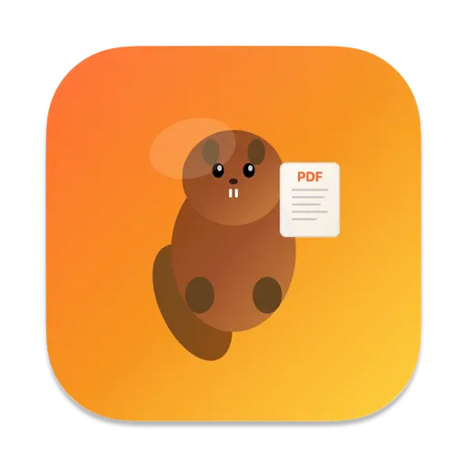
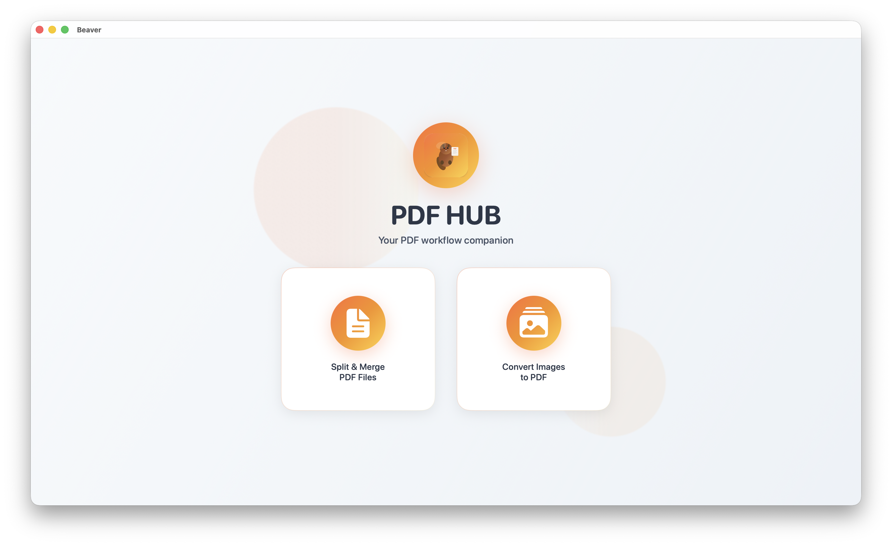
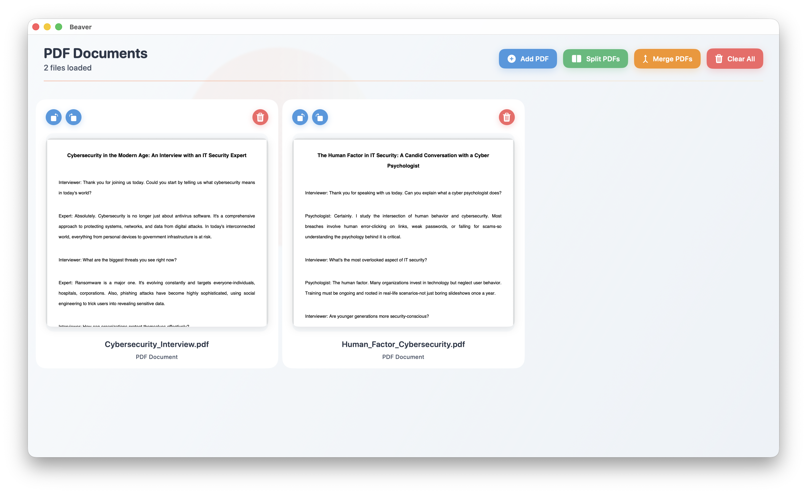
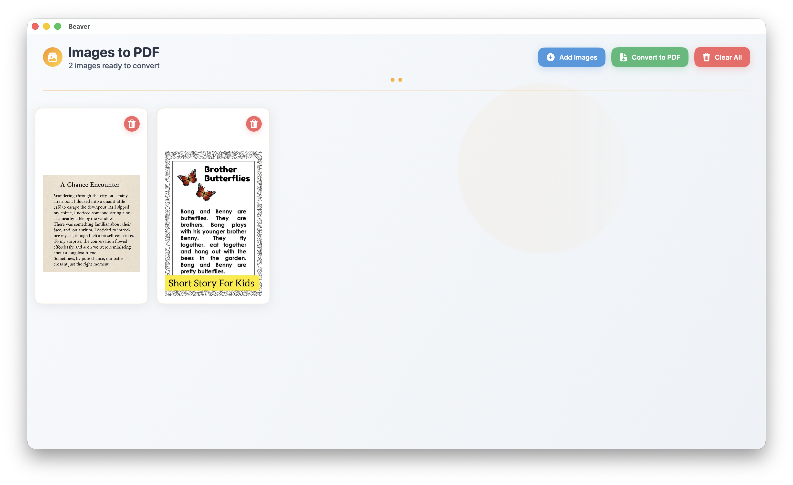

# Beaver

Beaver is an open-source macOS app for working with PDF files. You can convert one or more images into a single PDF, split a PDF into multiple documents, or merge multiple PDFs into one.

## Features

- Convert images to PDF
- Split PDF into separate pages
- Merge multiple PDFs into one

## Built With

- SwiftUI

## Getting Started

To run the project locally:

1. Clone the repository
2. Open the `.xcodeproj` file in Xcode
3. Build and run on macOS

You need to have Xcode installed.

## Screenshots

## Project Status

This project has been released and is actively maintained with ongoing updates.

## License

MIT License

Copyright (c) 2025 Eldar Tutnjic

Permission is hereby granted, free of charge, to any person obtaining a copy
of this software and associated documentation files (the "Software"), to deal
in the Software without restriction, including without limitation the rights
to use, copy, modify, merge, publish, distribute, sublicense, and/or sell
copies of the Software, and to permit persons to whom the Software is
furnished to do so, subject to the following conditions:

The above copyright notice and this permission notice shall be included in all
copies or substantial portions of the Software.

THE SOFTWARE IS PROVIDED "AS IS", WITHOUT WARRANTY OF ANY KIND, EXPRESS OR
IMPLIED, INCLUDING BUT NOT LIMITED TO THE WARRANTIES OF MERCHANTABILITY,
FITNESS FOR A PARTICULAR PURPOSE AND NONINFRINGEMENT. IN NO EVENT SHALL THE
AUTHORS OR COPYRIGHT HOLDERS BE LIABLE FOR ANY CLAIM, DAMAGES OR OTHER
LIABILITY, WHETHER IN AN ACTION OF CONTRACT, TORT OR OTHERWISE, ARISING FROM,
OUT OF OR IN CONNECTION WITH THE SOFTWARE OR THE USE OR OTHER DEALINGS IN THE
SOFTWARE.

## Author

Made by [31d4r (Eldar Tutnjic)](https://github.com/31d4r)
